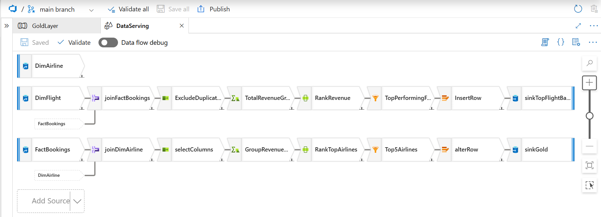
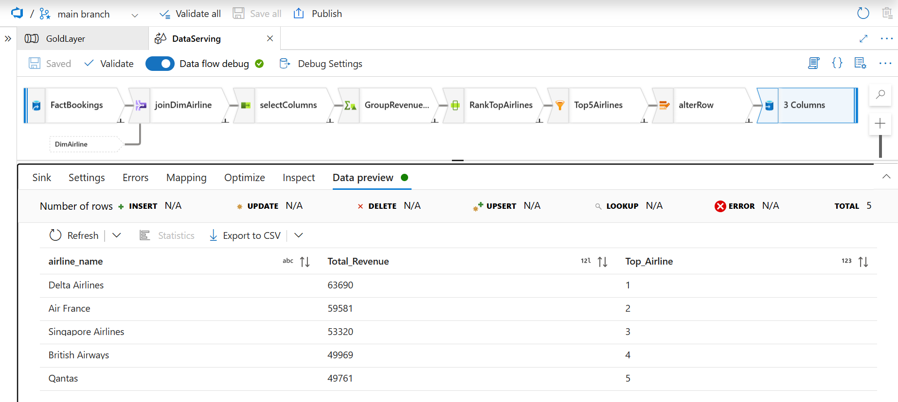
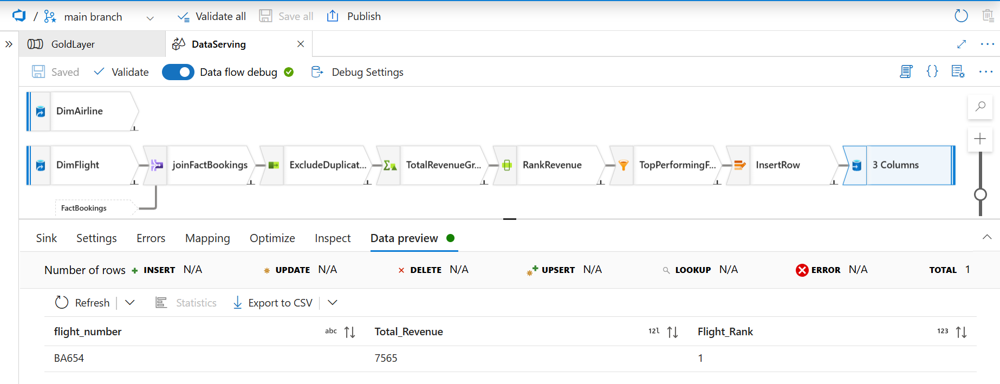
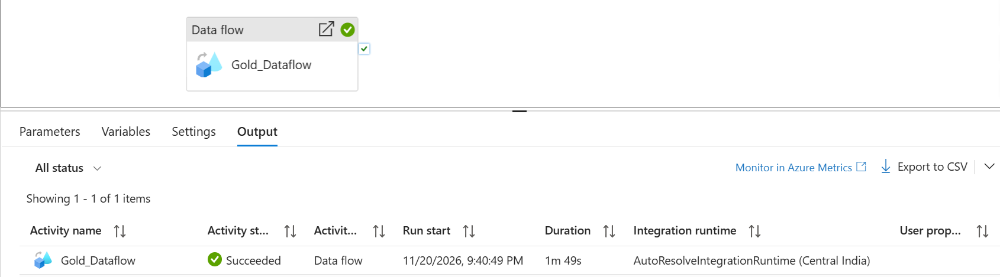
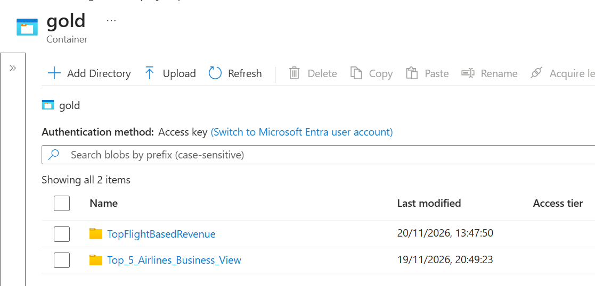

# ADF Gold Layer: Business Views with Mapping Data Flow (Delta Lake)

The final step of my bronze → silver → gold pipeline in Azure Data Factory (ADF). A **Mapping Data Flow** reads the cleaned tables from the **silver** container and builds two ready-to-use **business views** in the **gold** container, stored as **Delta Lake** tables:

1. **Top 5 airlines by revenue**
2. **Top-performing flight by revenue**



> Previous step: [ADF-Silver-Layer-DataFlow-Delta](https://github.com/arwak-codes/ADF-Silver-Layer-DataFlow-Delta), which cleans the raw data and writes the silver tables used here.

## What it does

```
silver (Delta)                                                       gold (Delta)
 FactBookings ─┬─ join DimAirline ─► total revenue per airline ─► rank ─► top 5 ──► Top_5_Airlines_Business_View
 DimAirline ───┘
 DimFlight ────┬─ join FactBookings ─► total revenue per flight ─► rank ─► top 1 ─► TopFlightBasedRevenue
 FactBookings ─┘
```

The pipeline `GoldLayer` has one activity, **Execute Data Flow** (`Gold_Dataflow`), which runs the data flow `DataServing`.

## The two business views

### 1. Top 5 airlines by revenue

| Step | Transformation | What it does |
|---|---|---|
| 1 | `joinDimAirline` (Join) | Left join `FactBookings` with `DimAirline` on `airline_id` to bring in the airline name |
| 2 | `selectColumns` (Select) | Keeps the booking columns plus `airline_name` and `country`, and avoids a duplicate `airline_id` column |
| 3 | `GroupRevenueByAirlineName` (Aggregate) | Groups by `airline_name` and sums `ticket_cost` into `Total_Revenue` |
| 4 | `RankTopAirlines` (Window) | Ranks airlines by `Total_Revenue`, highest first (`denseRank`) |
| 5 | `Top5Airlines` (Filter) | Keeps ranks below 6, so the top 5 |
| 6 | `alterRow` (Alter row) | Marks the rows for insert |
| 7 | `sinkGold` (Sink) | Writes to `gold/Top_5_Airlines_Business_View` |



### 2. Top-performing flight by revenue

| Step | Transformation | What it does |
|---|---|---|
| 1 | `joinFactBookings` (Join) | Left join `DimFlight` with `FactBookings` on `flight_id` |
| 2 | `ExcludeDuplicateColumns` (Select) | Picks the needed columns and removes the duplicate `flight_id` |
| 3 | `TotalRevenueGroupByFlightNumber` (Aggregate) | Groups by `flight_number` and sums `ticket_cost` into `Total_Revenue` |
| 4 | `RankRevenue` (Window) | Ranks flights by `Total_Revenue`, highest first (`denseRank`) |
| 5 | `TopPerformingFlight` (Filter) | Keeps rank below 2, so the top flight |
| 6 | `InsertRow` (Alter row) | Marks the rows for insert |
| 7 | `sinkTopFlightBasedRevenue` (Sink) | Writes to `gold/TopFlightBasedRevenue` |



## Sources and sinks

| Type | Name | Location | Format |
|---|---|---|---|
| Source | `DimAirline` | `silver` container | Delta |
| Source | `DimFlight` | `silver` container | Delta |
| Source | `FactBookings` | `silver` container | Delta |
| Sink | `sinkGold` | `gold/Top_5_Airlines_Business_View` | Delta |
| Sink | `sinkTopFlightBasedRevenue` | `gold/TopFlightBasedRevenue` | Delta |

Both sinks use **Overwrite**, so each run replaces the old result with fresh numbers.

### Inline datasets

The sources and sinks use **inline datasets**. The data flow itself holds the location, format, and linked service (`LS_datalake`) instead of pointing at separate dataset objects. That means fewer objects to manage. The trade-off is that you can't reuse the same dataset in other pipelines.

## Components

| Component | Details |
|---|---|
| Pipeline | `GoldLayer` |
| Activity | `Gold_Dataflow` (Execute Data Flow) |
| Data flow | `DataServing` (3 sources, 2 sinks) |
| Linked service | `LS_datalake` (Azure Data Lake Storage Gen2) |
| Compute | General purpose, 8 cores |

## How to recreate it

1. Make sure the silver Delta tables exist (see the previous project).
2. Create a Mapping Data Flow and add three **inline** Delta sources pointing to the silver tables.
3. Build the airline branch: Join → Select → Aggregate → Window (denseRank) → Filter (rank < 6) → Alter row (insert).
4. Build the flight branch: Join → Select → Aggregate → Window (denseRank) → Filter (rank < 2) → Alter row (insert).
5. Add an inline Delta sink for each branch in the `gold` container, with **Overwrite** on.
6. Create a pipeline with an **Execute Data Flow** activity, then **Publish all** and **Debug**.
7. Check the output folders in `gold`.

> Turn off **Data flow debug** when you're done. The debug cluster bills while it's running.

## Result

After a successful run, the `gold` container has two Delta folders: `Top_5_Airlines_Business_View` and `TopFlightBasedRevenue`.




## Project files

```
pipeline/
└── GoldLayer.json
dataflow/
└── DataServing.json
images/
```

JSON was exported from ADF Studio using the **{ }** code view. Linked services are intentionally not included because they can contain credentials.
